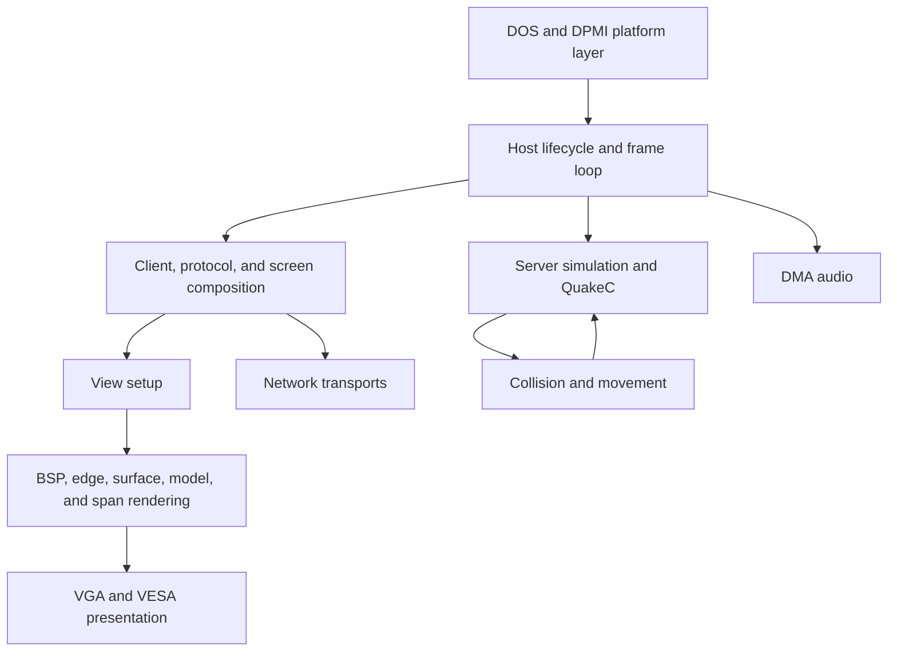

# Current architecture

This page describes the checked-in NitroQuake engine and its build boundaries.
For workspace ownership across the game and benchmark repositories, see the
[outer repository guide](../../../docs/repository-layout.md).

## Engine flow

The engine is predominantly single threaded. The host coordinates input,
commands, networking, client work, server simulation, audio, and presentation.
Client and server paths share engine structures and global state. The renderer
traverses world and entity data, builds edge and surface spans, and writes the
indexed framebuffer; video code presents it through the selected DOS mode.

Source directories express subsystem ownership, but they do not form fully
isolated modules. Shared headers, global data, C/assembly layouts, and legacy
calling conventions connect renderer, host, client, server, memory, and device
code. Narrow interfaces are being introduced incrementally; a directory or
header boundary alone does not prove runtime isolation.

## Build profiles and identity

The supported builder is [`BUILD-DOS.md`](../../BUILD-DOS.md). It provides the
`i486-release` and `c-reference` configurations, pins DJGPP inputs, records
resolved build identity, and applies source-bound and linked-image i486 ISA
checks. The C-reference profile is a comparison configuration and still
contains required assembly support code.

Product version and optimization build number are separate from the source and
configuration fingerprint. `tools/optimization-history.py` derives the
displayed build number from distinct accepted and rejected optimization
attempts. A supported numbered build requires a complete, non-shallow Git
history and fails when an attempt cannot be classified. See the
[optimization policy](../optimization/policy.md).

## Target constraints

The primary product is the 320x200 MS-DOS software renderer for i486-class
systems. Build and linked-image audits enforce the i486 instruction set. The
renderer also has large stack frames and a constrained contiguous DOS memory
arena; see the [memory budget](../memory-budget.md) before changing large
allocations or call paths.

The selector table and profiles allow assembly alternatives to be enabled and
compared against retained C implementations. The profile describes available
implementations; it does not by itself establish full assembly ownership or
visual parity. See [renderer status](renderer-status.md) and the
[selector review checklist](../SELECTOR-CHANGE-CHECKLIST.md).

## Evidence limits

Build success and an i486 ISA audit establish compiler integration and
instruction compatibility. They do not establish full C/assembly parity,
physical 486 performance, device behavior, or target-system reliability.
Emulator profiling ranks work under its recorded configuration. Performance
acceptance requires matched uninstrumented runs and deterministic correctness
evidence; physical-machine acceptance remains a separate gate.

The [benchmark documentation index](../../../benchmarks/docs/INDEX.md) describes
current measurement procedures and identifies dated results.
